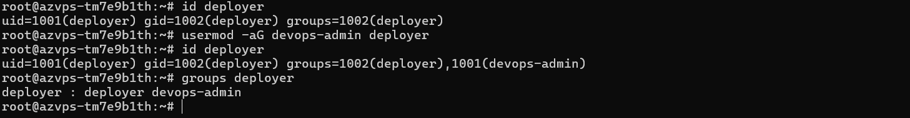
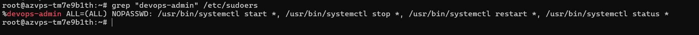
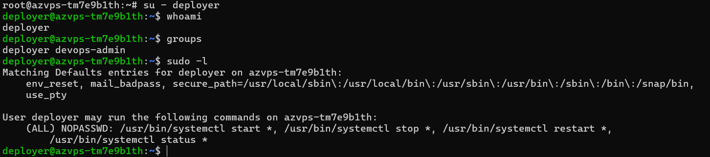

# BÀI 2: CẤU HÌNH PHÂN QUYỀN NHÓM VÀ SUDOERS

## 1. Mục tiêu

Thực hiện cấu hình phân quyền trên Ubuntu Server với các yêu cầu:

* Tạo group `devops-admin`.
* Tạo user `deployer`.
* Thêm user `deployer` vào group `devops-admin`.
* Cấu hình quyền sudo cho group `devops-admin` bằng `visudo`.
* Cho phép các thành viên trong group `devops-admin` thực hiện các lệnh:

  * `systemctl start *`
  * `systemctl stop *`
  * `systemctl restart *`
  * `systemctl status *`
* Các lệnh trên được thực hiện với quyền `sudo` mà không cần nhập mật khẩu.
* Kiểm tra thực tế bằng service `cron`.

---

## 2. Môi trường thực hiện

* Hệ điều hành: Ubuntu 22.04.1 LTS
* Server: AZVPS
* User quản trị ban đầu: `root`
* User được tạo: `deployer`
* Group được tạo: `devops-admin`
* Địa chỉ máy chủ: `160.30.157.205`
* SSH: Port `22`

---

## 3. Tạo group `devops-admin`

Kiểm tra group:

```bash
getent group devops-admin
```

Ban đầu chưa có kết quả nên tiến hành tạo group:

```bash
groupadd devops-admin
```

Kiểm tra lại:

```bash
getent group devops-admin
```

Kết quả:

```text
devops-admin:x:1001:
```

Group `devops-admin` đã được tạo thành công.

---

## 4. Tạo user `deployer`

Tạo user:

```bash
adduser deployer
```

Sau khi tạo, kiểm tra thông tin user:

```bash
id deployer
```

Kết quả:

```text
uid=1001(deployer) gid=1002(deployer) groups=1002(deployer)
```

User `deployer` đã được tạo thành công.

---

## 5. Thêm `deployer` vào group `devops-admin`

Thực hiện:

```bash
usermod -aG devops-admin deployer
```

Kiểm tra:

```bash
id deployer
```

Kết quả:

```text
uid=1001(deployer) gid=1002(deployer) groups=1002(deployer),1001(devops-admin)
```

Kiểm tra group của user:

```bash
groups deployer
```

Kết quả:

```text
deployer : deployer devops-admin
```

Như vậy user `deployer` đã thuộc group `devops-admin`.

### Hình ảnh minh chứng



---

## 6. Kiểm tra đường dẫn `systemctl`

Kiểm tra vị trí chương trình `systemctl`:

```bash
which systemctl
```

Kết quả:

```text
/usr/bin/systemctl
```

Đường dẫn `/usr/bin/systemctl` sẽ được sử dụng trong cấu hình `sudoers`.

---

## 7. Cấu hình sudoers bằng `visudo`

Mở file cấu hình sudoers bằng lệnh:

```bash
visudo
```

Thêm dòng sau vào cuối file:

```text
%devops-admin ALL=(ALL) NOPASSWD: /usr/bin/systemctl start *, /usr/bin/systemctl stop *, /usr/bin/systemctl restart *, /usr/bin/systemctl status *
```

Trong đó:

* `%devops-admin`: áp dụng cho tất cả thành viên của group `devops-admin`.
* `ALL=(ALL)`: cho phép thực hiện với quyền của user bất kỳ.
* `NOPASSWD`: không yêu cầu nhập mật khẩu khi sử dụng các quyền được cấp.
* `/usr/bin/systemctl start *`: cho phép start service.
* `/usr/bin/systemctl stop *`: cho phép stop service.
* `/usr/bin/systemctl restart *`: cho phép restart service.
* `/usr/bin/systemctl status *`: cho phép kiểm tra trạng thái service.

Kiểm tra lại cấu hình:

```bash
grep "devops-admin" /etc/sudoers
```

Kết quả:

```text
%devops-admin ALL=(ALL) NOPASSWD: /usr/bin/systemctl start *, /usr/bin/systemctl stop *, /usr/bin/systemctl restart *, /usr/bin/systemctl status *
```

### Hình ảnh minh chứng



---

## 8. Kiểm tra quyền sudo của `deployer`

Chuyển sang user `deployer`:

```bash
su - deployer
```

Kiểm tra user hiện tại:

```bash
whoami
```

Kết quả:

```text
deployer
```

Kiểm tra group:

```bash
groups
```

Kết quả:

```text
deployer devops-admin
```

Kiểm tra quyền sudo:

```bash
sudo -l
```

Kết quả:

```text
Matching Defaults entries for deployer on azvps-tm7e9b1th:
    env_reset, mail_badpass, secure_path=/usr/local/sbin\:/usr/local/bin\:/usr/sbin\:/usr/bin\:/sbin\:/bin\:/snap/bin,
    use_pty

User deployer may run the following commands on azvps-tm7e9b1th:
    (ALL) NOPASSWD: /usr/bin/systemctl start *, /usr/bin/systemctl stop *,
        /usr/bin/systemctl restart *, /usr/bin/systemctl status *
```

Kết quả cho thấy user `deployer` được phép thực hiện các lệnh `systemctl` đã cấu hình mà không cần nhập mật khẩu.

---

## 9. Kiểm tra `systemctl status cron`

Thực hiện:

```bash
sudo systemctl status cron
```

Kết quả:

```text
● cron.service - Regular background program processing daemon
     Loaded: loaded (/lib/systemd/system/cron.service; enabled; vendor preset: enabled)
     Active: active (running)
```

Trạng thái:

```text
Active: active (running)
```

cho thấy service `cron` đang hoạt động bình thường.

---

## 10. Kiểm tra `systemctl restart cron`

Thực hiện:

```bash
sudo systemctl restart cron
```

Lệnh thực hiện thành công và không yêu cầu nhập mật khẩu.

Sau đó kiểm tra lại:

```bash
sudo systemctl status cron
```

Kết quả cho thấy:

```text
Active: active (running)
```

Điều này chứng minh user `deployer` có thể sử dụng quyền:

```text
sudo systemctl restart *
```

theo cấu hình `NOPASSWD`.

### Hình ảnh minh chứng


(.png>))